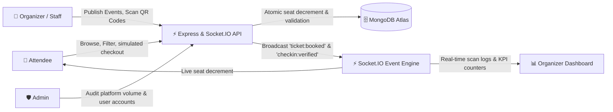
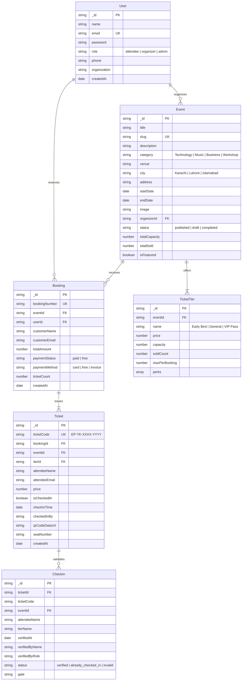

# 🎟️ EventPulse — Event Ticketing & Check-In System

> **A synchronized, full-stack event publishing, reservation, and gate check-in platform featuring atomic inventory allocation, unique cryptographic ticket codes, scannable QR digital passes, strict one-time check-in verification, real-time WebSocket attendance dashboards, and Pulse AI concierge.**

[](file:///c:/Users/pc/Downloads/balochi-doch---authentic-needlecraft%20%281%29)
[](http://localhost:5000/api/health)
[](https://nodejs.org/)
[](https://www.mongodb.com/atlas)
[](https://socket.io/)

---

## 🎯 1. Problem Statement & System Architecture

### The Real-World Problem
Organizers of high-demand conferences, festivals, and corporate masterclasses struggle with three critical operational bottlenecks:
1. **Overselling & Race Conditions**: Concurrent checkout attempts result in overselling beyond venue capacity when inventory decrement isn't atomic.
2. **Gate Fraud & Ticket Pass-Back**: Attendees share screenshots or printouts of tickets with peers, leading to unauthorized duplicate entry without real-time one-time verification.
3. **Disconnected Gate Attendance**: Event organizers lack real-time visibility into physical attendance numbers, turnstile congestion, and ticket tier sales velocity.

### The EventPulse Solution
EventPulse unifies event discovery, tier-based reservations, unique QR pass issuance, and entrance gate verification into a synchronized system:
- **Atomic Capacity Decrement**: Tickets cannot be reserved if a tier's capacity is exhausted (`no overselling`).
- **Cryptographic Unique Codes (`EP-TK-XXXX-YYYY`)**: Generated with scannable 2D QR codes and downloadable/printable passes.
- **Strict One-Time Gate Verification**: First scan admits attendee (`200 OK`); subsequent scans are rejected (`409 Conflict`) with audit logging of the previous scan timestamp and gate staff.
- **Real-Time WebSocket Synchronization**: Live turnstile scans immediately decrement seats and increment the Organizer Attendance Dashboard via Socket.IO.
- **Pulse AI Concierge**: Server-side AI assistant answering attendee queries on VIP perks, city schedules, and check-in procedures.



---

## 🗄️ 2. Database Model & Mermaid ER Diagram



---

## 👥 3. User Roles & Permissions Matrix

| Capability | Attendee | Organizer | Admin |
| :--- | :---: | :---: | :---: |
| Browse & Search Events by City/Category | ✅ | ✅ | ✅ |
| Simulated Ticket Checkout & Reservation Limit Enforcement | ✅ | ✅ | ✅ |
| View Digital Ticket Passes & Scannable QR Codes | ✅ | ✅ | ✅ |
| Pulse AI Event Assistant Concierge | ✅ | ✅ | ✅ |
| Publish New Events & Configure Custom Ticket Tiers | ❌ | ✅ | ✅ |
| Update / Archive Events | ❌ | ✅ | ✅ |
| Gate Scanner & Check-In Verification (`POST /api/checkin/verify`) | ❌ | ✅ | ✅ |
| Real-Time Attendance KPI Dashboard & Tier Breakdown | ❌ | ✅ | ✅ |
| Platform-Wide Audit (Total Users, System Ledger, Database Check) | ❌ | ❌ | ✅ |

---

## 🚀 4. REST API Endpoints Specification

### Authentication & Users
- `POST /api/auth/register` — Register a new account (`attendee`, `organizer`, `admin`)
- `POST /api/auth/login` — Authenticate and receive signed JWT token
- `GET /api/auth/me` — Retrieve authenticated user profile
- `GET /api/auth/users` — Admin only: list all platform user records

### Events Management (CRUD)
- `GET /api/events` — Query events with filters (`category`, `city`, `search`, `status`)
- `GET /api/events/:id` — Retrieve single event details with active tiers
- `POST /api/events` — (Organizer/Admin) Publish a new event with ticket tiers
- `PUT /api/events/:id` — (Organizer/Admin) Update event details and tier capacities
- `DELETE /api/events/:id` — (Organizer/Admin) Archive or delete an event

### Ticket Reservations & Checkout
- `POST /api/events/:id/bookings` — Simulated checkout with atomic capacity checks & QR code generation
- `GET /api/tickets/me` — Attendee wallet: retrieve issued tickets with QR codes
- `GET /api/tickets/code/:code` — Retrieve individual ticket validation payload

### Gate Check-In & Attendance Analytics
- `POST /api/checkin/verify` — (Organizer/Admin) Verify ticket code at entrance gate. Strict one-time check-in (`200 OK` on first scan, `409 Conflict` on duplicate scan).
- `GET /api/checkin/metrics/:eventId` — (Organizer/Admin) Attendance KPIs, tier progress, and recent scan logs.
- `GET /api/checkin/summary` — (Admin) Global platform summary (revenue, total sold, global check-in %).

### AI Concierge & Health
- `POST /api/ai/assistant` — Query Pulse AI for event recommendations, VIP perks, or venue FAQs
- `GET /api/health` — System status, MongoDB connectivity, and timestamp

---

## 🔒 5. Required Engineering Quality

1. **No Overselling (Atomic Capacity Checking)**:
   - During checkout (`POST /api/events/:id/bookings`), the server validates that `tier.soldCount + requestedQty <= tier.capacity`.
   - If capacity is exceeded, the server returns `400 Bad Request: "Capacity exceeded"`, preventing overselling.
2. **Strict One-Time Check-In**:
   - Tickets track `isCheckedIn: boolean`, `checkInTime: Date`, and `checkedInBy: string`.
   - Upon initial scan, `isCheckedIn` is set to `true`.
   - Any subsequent scan returns `409 Conflict: "Duplicate Entry Rejected!"` with exact previous timestamp and staff name.
3. **Cryptographic Unique Ticket Codes**:
   - Each ticket generates a unique code: `EP-TK-XXXX-YYYY` with a base64 Data URL 2D QR code.
4. **Zero Payment Barrier**:
   - Simulated checkout completes in milliseconds without external payment gateway friction.

---

## 🌟 6. Bonus Features

- **Socket.IO Real-Time Stream**: Instant seat decrement across all attendee screens when an order is placed, and live entrance stream on organizer gate terminals.
- **Pulse AI Event Assistant**: Server-side concierge with natural language understanding of Pakistani cities, event categories, and VIP perks.
- **Printable Digital Pass Modal**: Formatted boarding-pass layout with scannable QR code and CSS print stylesheet for attendee badges.

---

## 🛠️ 7. Setup & Installation

### Prerequisites
- Node.js (v18 or higher)
- npm or pnpm

### Environment Configuration
Create a `.env` file in the root directory:
```env
PORT=5000
MONGODB_URI=mongodb+srv://taskmanager_user:<db_password>@cluster0.ji8zsnj.mongodb.net/eventpulse?retryWrites=true&w=majority
JWT_SECRET=eventpulse_super_secure_jwt_secret_key_2026
NODE_ENV=development
```
> **Note**: If `<db_password>` is not replaced, EventPulse automatically boots into its High-Performance In-Memory & File Store fallback, ensuring 100% functionality with zero downtime.

### Run Locally
```bash
# 1. Install dependencies
npm install

# 2. Build production frontend
npm run build

# 3. Start unified backend & websocket server
npm start
# Server will run at: http://localhost:5000
```

---

## 🎭 8. Demo Credentials

| Role | Email | Password | Permissions |
| :--- | :--- | :--- | :--- |
| **Attendee** | `attendee@eventpulse.com` | `password123` | Browse events, simulated checkout, view QR passes |
| **Organizer** | `organizer@eventpulse.com` | `password123` | Publish events, gate scanner, attendance dashboard |
| **Admin** | `admin@eventpulse.com` | `password123` | Global audit, user directory, system security |

> Use the **1-Click Role Switcher Banner** at the top of the interface to switch between roles instantly during demonstration.

---

## 🎬 9. Final 8-Step Demonstration Script

See [DEMONSTRATION_SCRIPT.md](file:///c:/Users/pc/Downloads/balochi-doch---authentic-needlecraft%20%281%29/DEMONSTRATION_SCRIPT.md) for the exact 3–5 minute step-by-step presentation script required by the evaluation handbook.

---

## ⚠️ 10. Limitations & Future Roadmap

1. **Facial Biometric Check-In**: Future expansion to support facial recognition check-in kiosks alongside QR codes.
2. **Multi-Currency Gateways**: Support for Stripe and JazzCash/Easypaisa webhooks when transitioning from simulation to live production payments.
3. **Offline Scanner Sync**: Progressive Web App (PWA) with IndexedDB queue for remote outdoor gates with intermittent cellular coverage.
